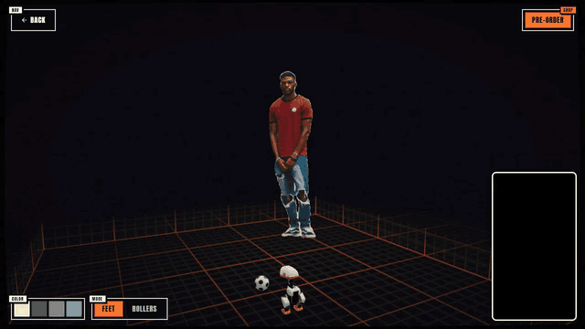
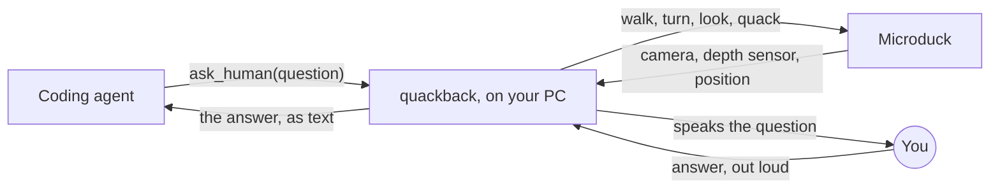

# quackback

*Rubber duck debugging, reversed. When your coding agent gets stuck, the duck waddles over and asks you.*



<sub>quackback driving the [Microduck simulator](https://huggingface.co/spaces/pollen-robotics/microduck-simulator), twice as fast as life. Bottom right: the duck's camera, and the person the detector on the PC found in it.</sub>

quackback is an [MCP](https://modelcontextprotocol.io) server built around one tool, `ask_human`.
When your coding agent (Claude Code, Codex, Cursor: anything that speaks MCP) is stuck on
something only you know, it calls the tool. A [Microduck](https://github.com/pollen-robotics/microduck)
robot looks around for you and walks over, your PC asks the question out loud, and your spoken
answer goes back to the agent as text. No robot? The PC asks on its own.

> **Status:** works with the simulated Microduck, and with voice on the PC alone. A real
> Microduck needs a connection to its robot runtime that is not written yet (see
> [the integration notes](docs/microduck-integration.md)).

## Install

One command, with [uv](https://docs.astral.sh/uv/getting-started/installation/):

```bash
uv tool install --python 3.13 --managed-python "quackback[sandbox] @ git+https://github.com/khamidollanurakhmet/quackback"
```

That is Python 3.13 as uv builds it, which has everything quackback needs (Tk, for the dialog);
some of the speech libraries have no builds for newer Pythons on every platform yet. It works on
Windows, macOS and Linux, on x86-64 and Arm, except Windows on Arm.

On Linux, install PortAudio first, for the microphone and speaker: `sudo apt install
libportaudio2` on Debian and Ubuntu.

Then download the models once (about 550 MB: a voice, a speech recogniser, a person detector)
and ask yourself a test question:

```bash
quackback download
quackback try                            # voice on this PC
QUACKBACK_ROBOT=sandbox quackback try    # with the simulated duck
```

(In PowerShell, set the variable first: `$env:QUACKBACK_ROBOT = "sandbox"`.) The simulator runs
in Edge or Chrome. Without either, or to record video, run `quackback setup-sandbox` once (on
Linux, Playwright's Chromium may also need [its system libraries](https://playwright.dev/python/docs/browsers#install-system-dependencies)).
For voice alone, without the simulator and its browser parts, leave out `[sandbox]`.

## Connect your coding agent

The MCP server is the `quackback` command, on stdio. `ask_human` waits for your answer for up to
`QUACKBACK_ASK_TIMEOUT` seconds (300 by default), so the agent must be willing to wait at least
that long. If a client cannot find `quackback` (a desktop app may not see your shell's `PATH`),
give it the full path: `uv tool dir --bin` prints the folder.

### Claude Code

```bash
claude mcp add --scope user --transport stdio quackback -- quackback
```

With the simulated duck:

```bash
claude mcp add --scope user --env QUACKBACK_ROBOT=sandbox --transport stdio quackback -- quackback
```

Check it with `claude mcp list`, or `/mcp` in a session. With the simulated duck, every session
that starts quackback opens a simulator window, so you may want that one without `--scope user`:
then it is for the current project only.

Claude Code moves a tool call that is still running after 2 minutes into the background and
carries on working; your answer still reaches it when you give it. To have it wait for you
instead, set `CLAUDE_CODE_MCP_AUTO_BACKGROUND_MS` to `0`, for example in
`~/.claude/settings.json`:

```json
{
  "env": { "CLAUDE_CODE_MCP_AUTO_BACKGROUND_MS": "0" }
}
```

If you have set `MCP_TOOL_TIMEOUT`, keep it above `QUACKBACK_ASK_TIMEOUT` in milliseconds, plus a
few seconds (`305000` for the default); `quackback` warns in its log when it is lower.

### Codex

```bash
codex mcp add quackback -- quackback
```

Codex gives a tool call 300 seconds by default, as long as quackback waits, so the answer could
arrive just too late. Codex also passes a server only a few of your environment variables. Fix
both in `~/.codex/config.toml`, where the command above put the server:

```toml
[mcp_servers.quackback]
command = "quackback"
tool_timeout_sec = 330
env = { QUACKBACK_ROBOT = "sandbox" }   # optional: the simulated duck; quackback settings go here
# Linux: let quackback reach your screen (the dialog, the simulator window) and your sound.
env_vars = ["DISPLAY", "WAYLAND_DISPLAY", "XDG_RUNTIME_DIR", "DBUS_SESSION_BUS_ADDRESS"]
```

### Any other MCP client

```json
{
  "mcpServers": {
    "quackback": {
      "command": "quackback",
      "env": { "QUACKBACK_ROBOT": "sandbox" }
    }
  }
}
```

Leave out `env` for voice alone, and set the client's tool timeout above 300 seconds if it has
one.

## How it works



The PC is the brain and the duck is the body: everything heavy runs on your PC, and the duck
only gets simple commands (walk, turn, look, quack), ten times a second, while its own walking
policy keeps its balance.

1. **The agent asks.** It calls `ask_human` with the question, a sentence of context, and
   choices if there are any.
2. **The duck finds you.** It stands and looks around with its head camera; the pictures come
   to the PC, where [MediaPipe](https://ai.google.dev/edge/mediapipe)'s person detector looks for
   you. Then it walks over, steered from the PC, and stops when its depth sensor has you well
   clear of 40 cm (about 65 cm in the simulator). It turns its head to face you and quacks.
3. **The PC asks.** [Piper](https://github.com/OHF-Voice/piper1-gpl) speaks the question, and
   [faster-whisper](https://github.com/SYSTRAN/faster-whisper) writes down your answer. Both run
   on your machine; audio never leaves it and is never saved. With choices, the answer is
   matched to the closest one.
4. **The agent gets the answer,** and the duck walks home: before it turns round, it looks about
   and turns only the way that keeps it clear of you.

If something does not work, the question still gets asked:

- no duck, or it cannot find you within 30 seconds: your PC asks;
- no microphone or speaker, or the voice cannot make out your answer: a dialog on your screen;
- no answer within the timeout: the agent hears "The human did not answer. Make a reasonable
  decision and note it." and carries on.

**Your voice answers questions; it never grants permission.** Anyone in the room, or a video
playing nearby, can answer. The tool tells the agent so: a spoken answer is not approval for
deploys, deletions, payments or anything else risky.

## The simulated duck

The [Microduck simulator](https://huggingface.co/spaces/pollen-robotics/microduck-simulator)
runs the real trained walking policy in your browser. quackback drives it like a robot, adds a
duck's-eye camera and depth sensor to the page, and puts a stand-in person in the arena (you
cannot stand in a browser tab).

- It shows the question above the scene; the simulator's own sound is off upstream, so your PC
  speaks it.
- Whenever it walks, the duck stops for anything its depth sensor sees closer than 50 cm in its
  way, and it stops by itself within half a second if quackback stops sending commands.
- The server's second tool, `stop_robot`, stops the duck at once; it stays put, without walking
  home, until the next question.
- Your keyboard or gamepad always overrides quackback in the simulator, as on the real robot.
- quackback switches the page's multiplayer off, so other visitors never see your duck.
- Keep the simulator window open, not minimized: a minimized browser stops drawing, and the duck
  sees nothing.
- MediaPipe has no build for Intel Macs, so there the duck walks blind to
  `QUACKBACK_ROBOT_TARGET` and stops 40 cm short. So it does with `QUACKBACK_FIND_PERSON=false`,
  or without the `vision` extra (which comes with `sandbox`).

## Settings

Environment variables, or the same names without `QUACKBACK_`, in lower case, in `config.toml`
(`ask_timeout = 600`, `robot = "sandbox"`). That file is in `%APPDATA%\quackback\` on Windows,
`~/Library/Application Support/quackback/` on macOS, `~/.config/quackback/` on Linux, or wherever
`QUACKBACK_CONFIG` points; a name quackback does not know stops it from starting, with a message
saying which.

| Variable | Default | |
|---|---|---|
| `QUACKBACK_ASK_TIMEOUT` | `300` | seconds to wait for an answer |
| `QUACKBACK_VOICE` | `true` | `false`: skip speech, use the dialog |
| `QUACKBACK_WHISPER_MODEL` | `small.en` | any faster-whisper model, e.g. `base.en`, `large-v3-turbo` |
| `QUACKBACK_LANGUAGE` | `en` | Whisper language; empty to detect |
| `QUACKBACK_PIPER_VOICE` | `en_US-lessac-medium` | a [Piper voice](https://huggingface.co/rhasspy/piper-voices) name or a path to an `.onnx` voice |
| `QUACKBACK_INPUT_DEVICE` / `QUACKBACK_OUTPUT_DEVICE` | system default | a device name or index |
| `QUACKBACK_LOG_FILE` | none | also log here (logs always go to stderr) |
| `QUACKBACK_ROBOT` | `none` | `sandbox`: the Microduck simulator walks over to ask |
| `QUACKBACK_FIND_PERSON` | `true` | let a duck with a camera look for you (needs the `vision` extra) |
| `QUACKBACK_PERSON_SEARCH_TIMEOUT` | `30` | seconds to look before asking on the PC instead |
| `QUACKBACK_ROBOT_TARGET` | `1.5,0.0` | where you are: metres forward, left of the duck's start. A duck that cannot look for you walks there and stops 0.4 m short |
| `QUACKBACK_MAX_SPEED` / `QUACKBACK_MAX_TURN` | the robot's | speed caps, m/s and rad/s (the simulator needs 0.25 m/s: a lower cap keeps it from walking) |
| `QUACKBACK_SANDBOX_BROWSER` | Edge on Windows, else Chrome | a Playwright channel, e.g. `chrome`, `msedge` |
| `QUACKBACK_SANDBOX_HEADLESS` | `false` | run the simulator without a window |
| `QUACKBACK_SANDBOX_RECORD_DIR` | none | record the simulator as video (run `quackback setup-sandbox` once) |
| `QUACKBACK_SANDBOX_PERSON` | at `ROBOT_TARGET` | where the stand-in person stands, `forward,left` like `ROBOT_TARGET`; `none` for nobody |
| `QUACKBACK_SANDBOX_PERSON_IMAGE` | the bundled one | a picture of the stand-in person, ideally a PNG with a transparent background |

## Privacy

- Audio is never written to disk, and the duck's camera pictures are never saved either.
- Speech recognition, speech and person detection all run on your PC.
- **MediaPipe and Google.** MediaPipe sends Google usage metrics (not pictures) when a detector
  is shut down, and has no setting to turn that off. quackback never shuts its detector down: it
  lives as long as the quackback process and is dropped at exit without that call. Set
  `QUACKBACK_FIND_PERSON=false`, or install without the `vision` extra, to not run MediaPipe at
  all.
- The models are downloaded once: the voice and speech recogniser from Hugging Face, the
  detector's model (EfficientDet-Lite0, 4.6 MB) from Google's MediaPipe model storage, checked
  against a pinned hash.

## Development

```bash
uv sync
uv run ruff check
uv run ruff format --check
uv run pytest
QUACKBACK_TEST_MODELS=1 uv run --extra vision pytest -m models   # the real voice and detector models
uv run --extra sandbox quackback setup-sandbox   # once: Playwright's ffmpeg (and Chromium)
QUACKBACK_TEST_SANDBOX=1 uv run --extra sandbox pytest -m sandbox   # against the simulator website
uv run --extra sandbox python scripts/record_demo.py demo/   # records the demo video and GIF
```

Enable the commit-msg hook once per clone:

```bash
git config core.hooksPath .githooks
```

## Credits

quackback builds on [Microduck](https://github.com/pollen-robotics/microduck) by Pollen Robotics /
Hugging Face (Apache-2.0). Speech uses [Piper](https://github.com/OHF-Voice/piper1-gpl) and
[faster-whisper](https://github.com/SYSTRAN/faster-whisper); the duck sees with
[MediaPipe](https://ai.google.dev/edge/mediapipe) (Apache-2.0). The simulator's stand-in person
is a cutout of a CC0 photo by Mohammad Faruque on StockSnap (details in
`src/quackback/robot/assets/README.md`).

## License

quackback is [Apache-2.0](LICENSE). Note that one of its dependencies, piper-tts, is GPL-3.0
(it bundles espeak-ng).
